  

  

  

<h2 align="center">🛠️ Stack</h2>

  
  
  
  
  
  
  
  
  
  
  
  

<h2 align="center">🎨 Herramientas</h2>

  
  
  
  

<h2 align="center">🎯 Lo que hago mejor</h2>
<table align="center">
  <tr>
    <td align="center">⚛️ <b>Interfaces con React</b> Componentes reutilizables y escalables</td>
    <td align="center">🎨 <b>Del diseño al código</b> Figma a píxel perfecto</td>
    <td align="center">⚡ <b>Performance</b> Next.js, SSR y carga rápida</td>
    <td align="center">♿ <b>Accesibilidad</b> UI inclusiva con Radix</td>
  </tr>
</table>

<h2 align="center">📊 Mis Estadísticas</h2>

  

 

<h2 align="center">🌐 Conectemos</h2>

  

📫 ¿Tienes un proyecto o una idea? Escríbeme a <a href="mailto:phoenixpinnock@gmail.com">phoenixpinnock@gmail.com</a>

<code>&lt;/&gt;</code> Hecho con ☕ y mucho <b>React</b>

